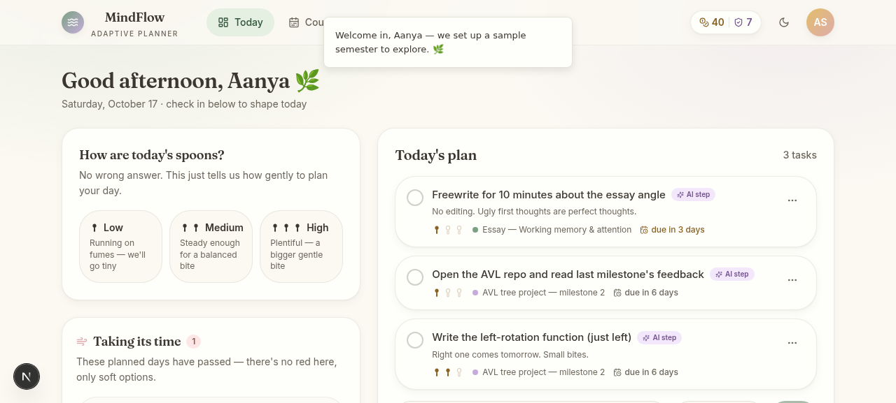
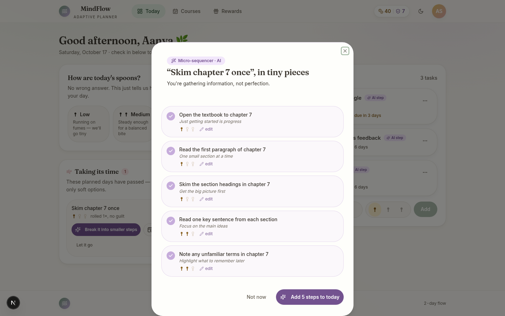
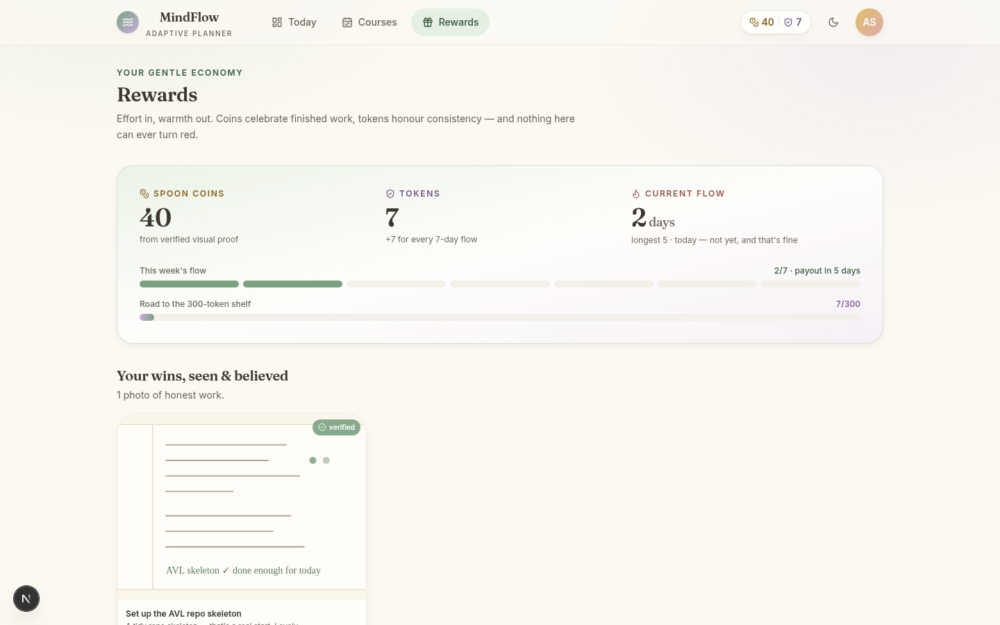
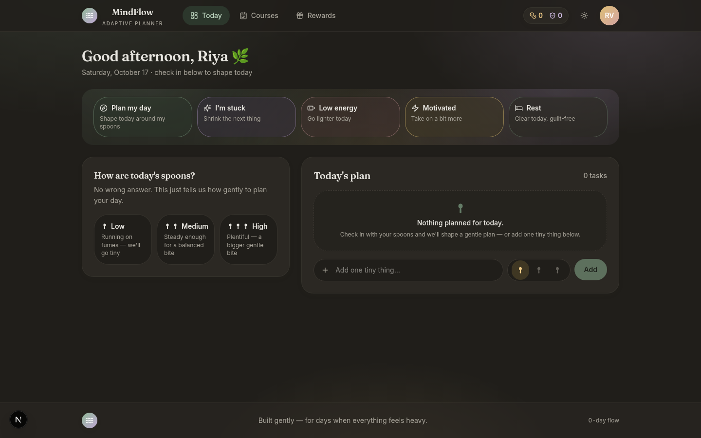
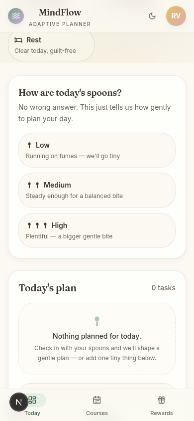

# MindFlow

## Plan around your energy, not against it.

MindFlow is a gentle, adaptive planner for students dealing with ADHD, executive dysfunction,
anxiety, and task paralysis. It replaces rigid deadlines and guilt-inducing badges with
energy-aware sequencing, microscopic AI-generated steps, and a reward loop built on trust
instead of pressure.

## How it works

**1. Check in — get a plan that fits.** A daily Low / Medium / High energy check-in sets the
day's capacity (2 / 4 / 7 spoons). The plan fills up to that budget, never beyond it.

**2. Shrink anything in one tap.** An LLM breaks intimidating work into embarrassingly small
steps — each one an action verb, ten minutes or less (five on low energy). Every step can be
accepted, edited, or skipped. The AI suggests; it never decides.

**3. Show your win, earn coins.** Completing a task can include an optional photo proof — a
notebook page, a code editor, a solved problem set. A vision model reads it generously and
responds with encouragement. Coins are always awarded, even on the benefit of the doubt.

**4. Consistency pays, gently.** A week of showing up pays +7 tokens, unlocking a goodie shelf
at 150 / 200 / 250 / 300 tokens. A broken streak never erases history — longest streak is kept
alongside the current one.

## The five modes

| Mode | For when… | What it does |
| --- | --- | --- |
| Plan My Day | Starting out | Builds a spoon-shaped plan from today's energy |
| I'm Stuck | Task paralysis | Pick the blocker, get a reason-aware micro-breakdown |
| Low Energy | Running on empty | Suggests the single lightest task; parks the heavy ones |
| Motivated | A rare good day | Choose a load ceiling — momentum, not pressure |
| Rest | Burnout prevention | Shows exactly what moves to tomorrow, then rolls it |

## No red. No alarms. No shame.

There is no red color anywhere in MindFlow. Due labels are warm honey and peach. Rollovers
say "no guilt." Letting go is a first-class action with an honest explanation of what
disappears and what doesn't. Low energy is treated as information, not failure — the plan
changes, the tone never does.

## Screenshots

**Today, shaped like your spoons**


**AI-generated micro-steps — every one editable**


**Wallet, photo proofs, and the goodie shelf**


**Evening — a warm cocoa dark theme, never blue-black**


**Thumb-reachable at 390px**


## Run it locally

```bash
bun install && bun run db:push && bun run dev
```

Full setup, architecture, and API reference: see the project README in the repository root.
